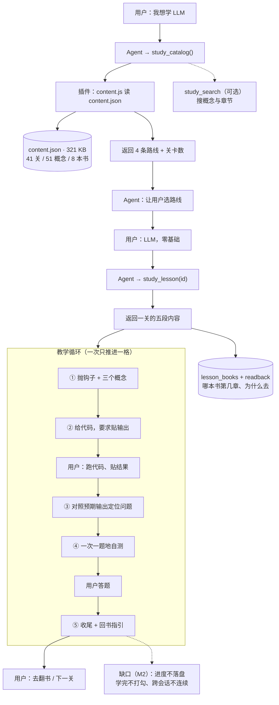

# 插件工作流程（v0.1）

图见 [flow.png](flow.png)（GitHub 可直接看 Mermaid 版，见下）。



## 两条离线链路

**内容构建**（改完内容要重跑）：

```
course/*.json + graph/concepts.json + mindmap/sections.json + readlist/readback
   → scripts/pack_content.py（校验：每关 3 概念 / 页码存在性）
   → plugin/content/content.json
```

**安装**（一次即生效，重启后仍在）：

```
git clone → plugin/ pnpm install → DSH Plugins → Add plugin → 工具注入所有会话
```
