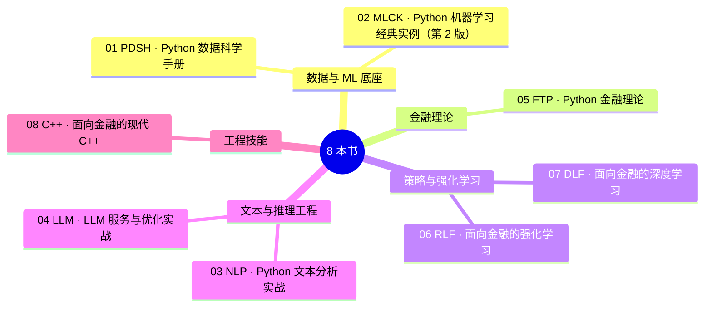

# 8 本书 · 中英对照思维导图（Mermaid）

> 交互版（可缩放、五层折叠）见 `books-mindmap.html`。下面每本书单独一页，避免单文件过大。

## 总览

## 分册

- [[md/01-PDSH|01 PDSH]] — Python 数据科学手册
- [[md/02-MLCK|02 MLCK]] — Python 机器学习经典实例（第 2 版）
- [[md/03-NLP|03 NLP]] — Python 文本分析实战
- [[md/04-LLM|04 LLM]] — LLM 服务与优化实战
- [[md/05-FTP|05 FTP]] — Python 金融理论
- [[md/06-RLF|06 RLF]] — 面向金融的强化学习
- [[md/07-DLF|07 DLF]] — 面向金融的深度学习
- [[md/08-Cpp|08 C++]] — 面向金融的现代 C++